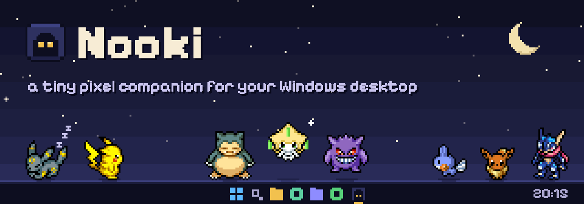
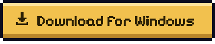
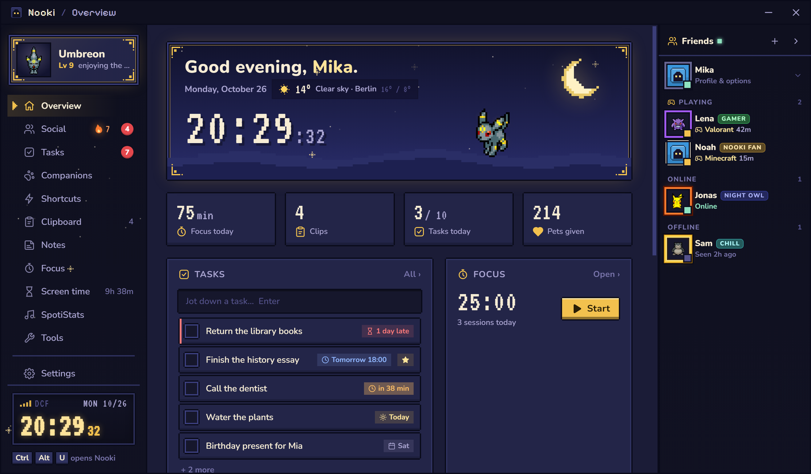
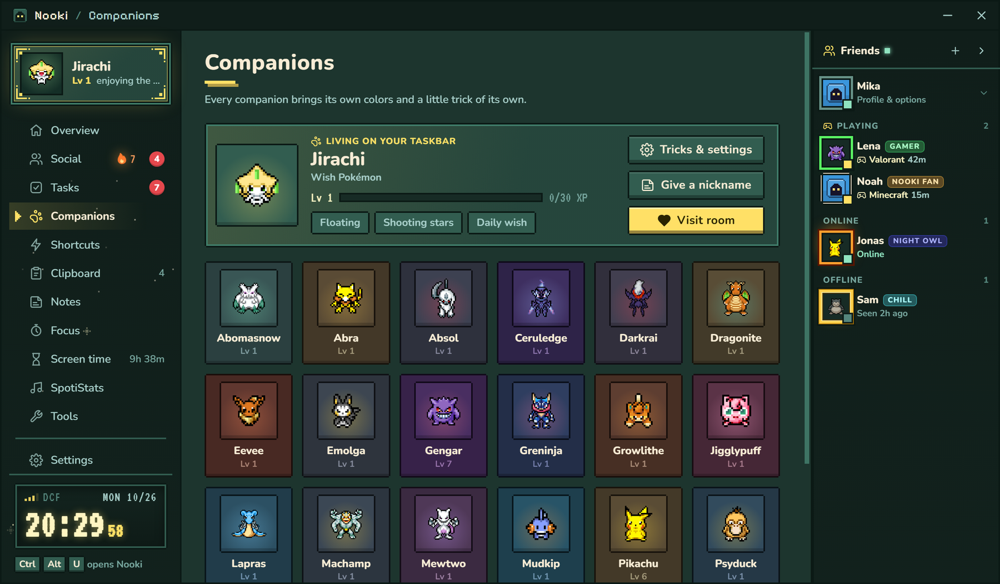
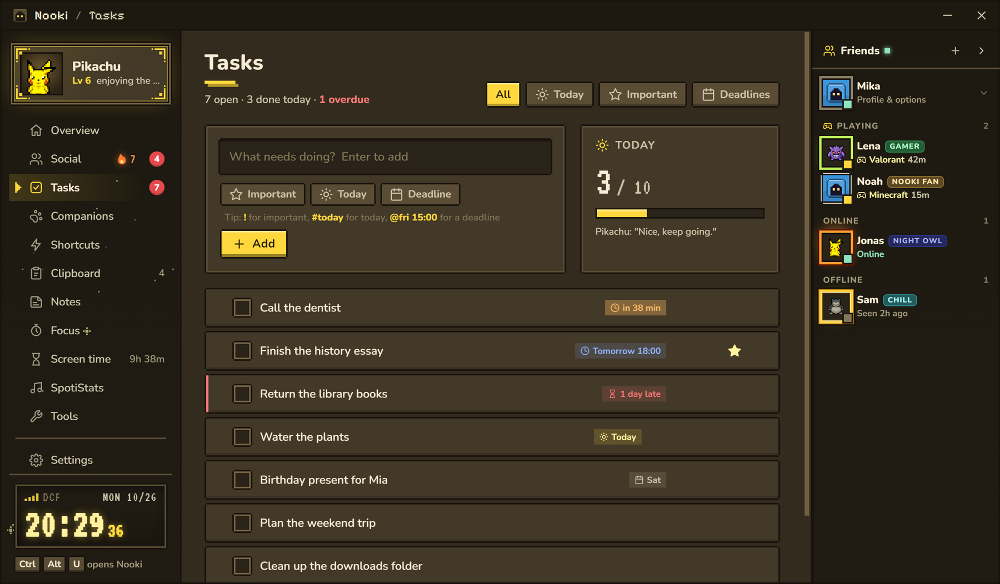
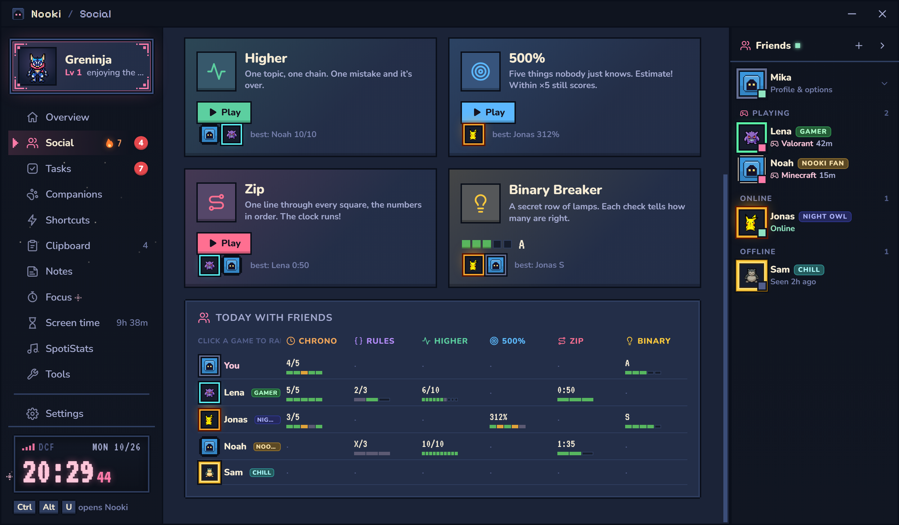
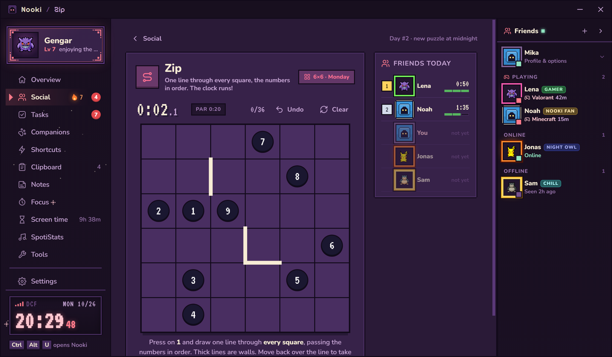
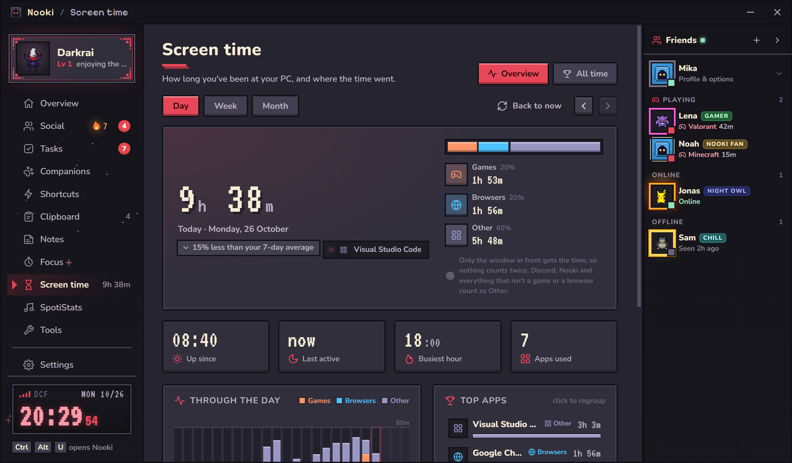
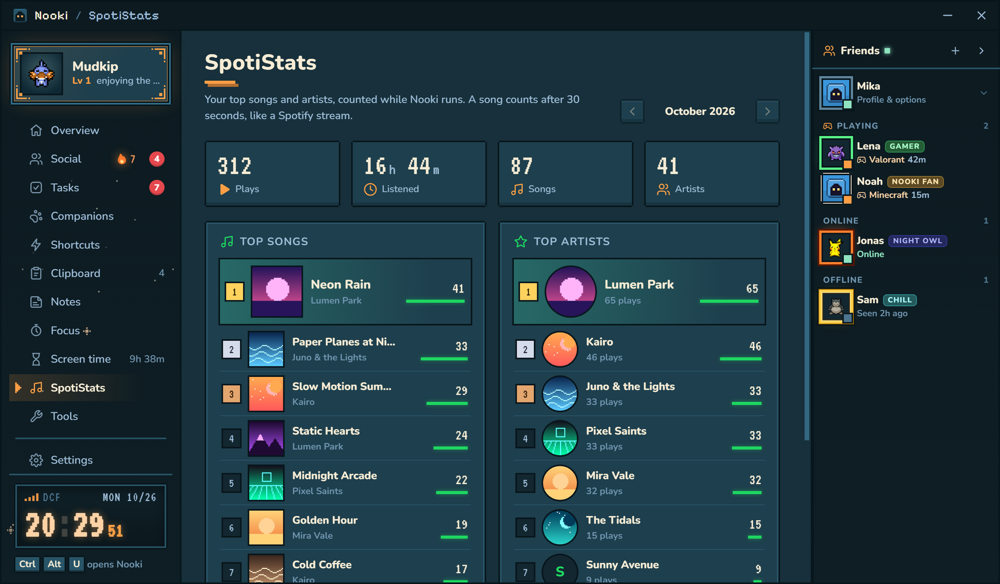
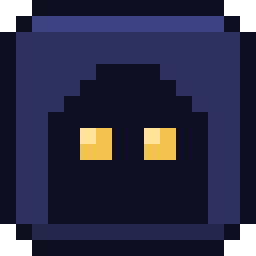

  

  

  
  
  
  

  <a href="#companions">Companions</a> ·
  <a href="#tasks-notes-and-focus">Tasks</a> ·
  <a href="#daily-games-with-friends">Daily games</a> ·
  <a href="#your-stats">Stats</a> ·
  <a href="#little-tools">Tools</a> ·
  <a href="#install">Install</a>

 

Nooki is a tiny pixel companion that lives on your taskbar. It wanders around, naps when you're away and cheers when you finish something. It also keeps the small things of your day in one cozy place: tasks, notes, your clipboard, a focus timer, daily puzzles with friends and a few tools you'll keep using. All of it stays on your PC.

  

## Companions

Pick one of **23 companions**. Each one paints the whole app in its colors and has a trick of its own: Pikachu crackles with static, Snorlax makes the ground shake when it lands, Mudkip reminds you to drink water, Jirachi grants one wish a day, Umbreon glows at night. Feed them, play with them and level up your bond.

  

Your companion on the desktop:

| Do this | And it… |
| --- | --- |
| Click it | opens the quick menu: your shortcuts, the color picker, the sound mixer and music controls |
| Double-click it | opens Nooki |
| Drag it | carries it anywhere. Hold the right mouse button while dragging to take a screenshot |
| Hold the right mouse button on it | gets petted |
| Shift + click | goes to sleep (click to wake it) |
| Drop files on it | keeps them in its stash |
| Drop a link on it | shows its QR code and copies it to your clipboard |

## Tasks, notes and focus

Write a task and it's there. Type `!` for important, `#today` for today and `@fri 15:00` for a deadline: your companion reminds you a day before, an hour before and when time's up. The task list also sits on your taskbar, one click away.

  

- **Quick notes** that open right where you are (<kbd>Ctrl</kbd> <kbd>Alt</kbd> <kbd>N</kbd>)
- **Clipboard history**: everything you copied, with pins (<kbd>Ctrl</kbd> <kbd>Alt</kbd> <kbd>V</kbd>)
- **Color picker** for any pixel on your screen, with a loupe and every format (<kbd>Ctrl</kbd> <kbd>Alt</kbd> <kbd>C</kbd>)
- **Focus timer** with breaks, tied to the task you're on
- **Gentle reminders** to drink water and stretch, if you want them

## Daily games with friends

Six small puzzles a day, the same for everyone: **Chrono**, **Rulebreaker**, **Higher**, **500%**, **Zip** and **Binary Breaker**. Add friends with their code and see who's online and what they're playing. Compare today's results and keep your streak going. Friends' companions even drop by on your desktop now and then.

<table>
  <tr>
    <td width="50%"></td>
    <td width="50%"></td>
  </tr>
</table>

Make your profile yours with page themes, picture frames and titles you unlock by playing. Your Discord profile can show that you're hanging out with Nooki.

## Your stats

<table>
  <tr>
    <td width="50%"></td>
    <td width="50%"></td>
  </tr>
  <tr>
    <td><b>Screen time</b>: how long you've been at your PC and where the time went (games, browsers, everything else), by day, week and month.</td>
    <td><b>SpotiStats</b>: your top 10 songs and artists of the month. A song counts after 30 seconds, like a Spotify stream.</td>
  </tr>
</table>

## Little tools

- **Sound mixer**: the volume of every app, from your companion's menu
- **Autoclicker** with its own hotkey and pause between clicks
- **Music controls** for Spotify and other players, with the cover art
- **Quick launch** for apps, folders and websites
- **Weather** for your city on the start page
- **Updates** install by themselves; your data stays

## Install

1. Download `Nooki-Setup-x.y.z.exe` from the [latest release](https://github.com/nwcl0ud/nooki/releases/latest) and run it.
2. Nooki isn't code-signed yet, so Windows may show a SmartScreen warning. Click **More info**, then **Run anyway**.
3. That's it. Nooki starts with Windows (you can turn that off) and keeps itself up to date.

| Shortcut | Opens |
| --- | --- |
| <kbd>Ctrl</kbd> <kbd>Alt</kbd> <kbd>U</kbd> | Nooki |
| <kbd>Ctrl</kbd> <kbd>Alt</kbd> <kbd>T</kbd> | Tasks |
| <kbd>Ctrl</kbd> <kbd>Alt</kbd> <kbd>N</kbd> | A quick note |
| <kbd>Ctrl</kbd> <kbd>Alt</kbd> <kbd>V</kbd> | Clipboard history |
| <kbd>Ctrl</kbd> <kbd>Alt</kbd> <kbd>C</kbd> | Color picker |

You can change all of them in Settings.

## Privacy

- Your tasks, notes, clipboard, screen time and listening stats stay on your PC, in `%APPDATA%\Nooki`.
- Friends is off until you turn it on. Then the Nooki server knows your name, your companion, your profile, whether you're online and your daily game results. Only your friends see them.
- The weather only sends your city's position to [Open-Meteo](https://open-meteo.com).
- The Discord status can be switched off in Settings.

## Credits

Sprites from the [PMD Sprite Collab](https://sprites.pmdcollab.org). Weather by [Open-Meteo](https://open-meteo.com). Built with [Electron](https://www.electronjs.org).

   
  Made with care for everyone who likes a little company on their desktop.

